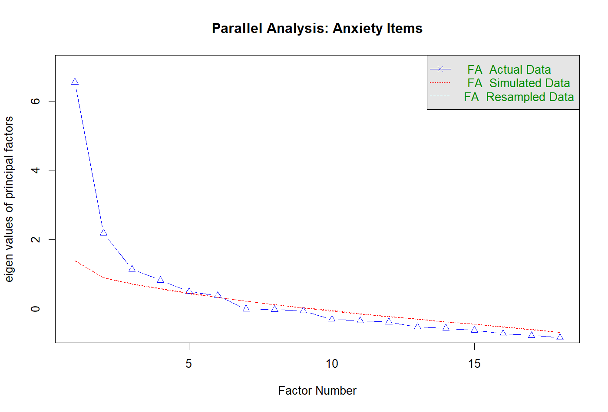
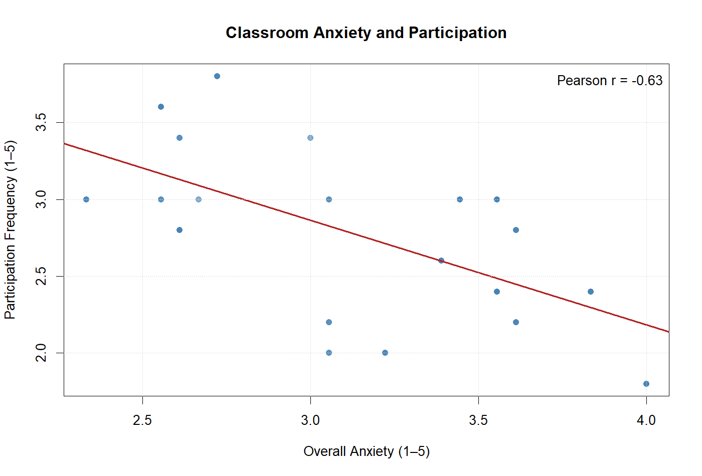

# Classroom Participation Anxiety Scale

## Project Overview

This project developed an 18-item, three-factor Likert scale to measure classroom participation anxiety and examine its relationship with student engagement. Using R, the study analyzed 60 student survey responses to evaluate internal consistency, explore the underlying factor structure, and identify potential barriers to classroom participation.

## Questionnaire Design

The questionnaire contains 23 items measured on a 5-point Likert scale:

- **Q1–Q6:** Fear of Speaking
- **Q7–Q12:** Fear of Negative Evaluation
- **Q13–Q18:** Avoidance Behavior
- **Q19–Q23:** Participation Frequency

The first 18 items measure classroom participation anxiety, while the remaining five assess participation frequency.

The uploaded [Item Pool](item%20pool.docx) provides the full questionnaire and explains the meaning of each variable (Q1–Q23).

## Methodology

The R analysis includes:

- Data preprocessing and reverse coding
- Descriptive statistics
- Reliability analysis using Cronbach's Alpha
- Exploratory Factor Analysis (EFA)
- KMO and Bartlett's tests
- Pearson correlation analysis
- Statistical visualization

## Key Findings

- **Cronbach's α = 0.88**, indicating good overall internal consistency.
- **Three-factor EFA explained 60.5%** of item variance.
- **Pearson r = -0.63 (p < 0.001)**, indicating a significant negative association between classroom anxiety and participation frequency.
- Avoidance behavior showed the highest average score among the three anxiety dimensions.

The relatively low KMO value (0.44) and limited sample size suggest that the factor structure requires further validation.

## Data Privacy and Availability

This study used **60 real student survey responses**. To protect participant privacy, the original individual-level dataset is not publicly shared.

The repository includes the R analysis code, questionnaire item pool, aggregated statistical results, and visualizations. These materials allow readers to examine the methodology and reported findings, while full computational reproduction requires authorized access to the original dataset.

## How to Run

Install the required R packages:

```r
install.packages(c("readxl", "psych"))
```

Place an authorized dataset named `data analyze.xlsx` alongside `classroom_participation_anxiety_analysis.R` and run the script in RStudio.

The analysis automatically generates statistical tables, visualizations, and a summary report in the `outputs/` folder.

## Visualizations

**Parallel Analysis**



**Anxiety and Participation Relationship**


